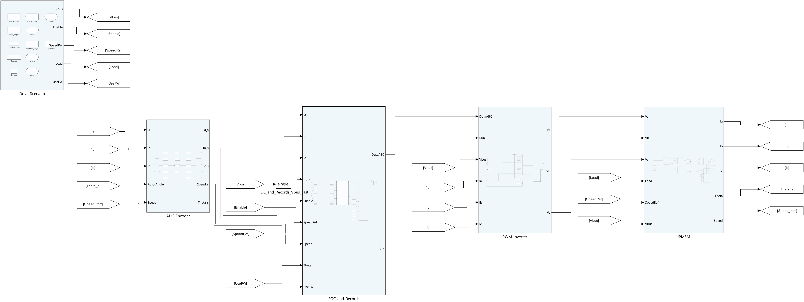
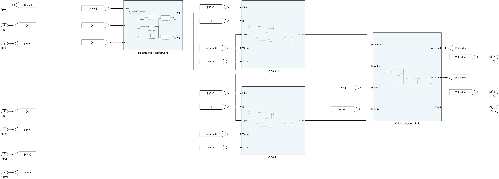

# 电机控制 Simulink 仿真学习工程

**Motor Control Simulink Examples** · 从控制原理、模块搭建到生成 C 代码的电机仿真工程集。

这里按主题收录完整学习工程：先读模型总览，再进入算法子系统，运行同一台电机的对比工况，最后查看仿真数据和 C 代码验证记录。每个工程提供模型、参数、运行入口与结果说明。

## 工程目录

| 编号 | 学习主题 | 内容 | 下载与说明 |
|---|---|---|---|
| 02 | IPMSM 弱磁扩速 · Morimoto 1990 | 电流圆与电压椭圆、MTPA/弱磁对比、开关级整机、可移植离散控制器、ERT C 回放 | [工程介绍](examples/02-morimoto-1990-field-weakening/) · [完整 ZIP](https://github.com/YANG985-CMD/motor-control-simulink-examples/releases/download/morimoto-1990-v1.0.0/morimoto1990-ipmsm-field-weakening-readable-v1.0.0.zip) |

编号与电机经典论文视频系列对应，目前先发布第 02 期工程。

## 先下载，再打开

1. 点击上面的 **完整 ZIP**，或进入 [Releases](https://github.com/YANG985-CMD/motor-control-simulink-examples/releases) 下载工程包。GitHub 的绿色 “Code → Download ZIP” 下载的是本仓库的说明与预览，完整仿真工程通过 Releases 单独提供。
2. 解压后进入 `仿真工程_可读移植版`，阅读其中的 `README.md`。
3. 使用 MATLAB R2024b，按[工程介绍](examples/02-morimoto-1990-field-weakening/#运行方法)中的说明设置运行缓存位置，再打开模型或执行仿真。

## 模型预览

整机包括工况与采样、FOC 控制器、PWM 与逆变器、电机及机械负载。

关键控制算法由可展开的原生模块构成。d/q 电流控制按照信号流程排布，控制器与仿真试验台分开。

## 每份工程如何学习

- **看结构**：从整机顶层进入控制器，了解采样、控制、调制与电机之间的连接。
- **跑工况**：使用同一台电机、相同负载与母线条件，对照不同控制策略。
- **读数据**：核对原始时间序列、指标定义和统计窗口。
- **看实现**：查看离散控制接口、生成的 C 源码、板级适配示例和主机回放结果。

各工程单独记录 MATLAB 版本、所需产品与验证范围。论文原始结论与本工程仿真结果分别说明。

相关建模方法：[Simulink 清晰建模与模块移植](https://github.com/YANG985-CMD/embedded-foc-simulink-codegen/tree/main/skills/simulink-readable-modeling)。
