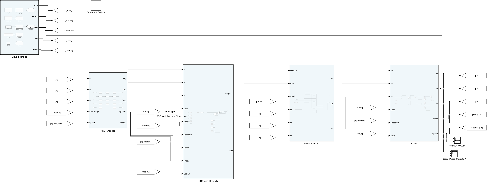

# 电机控制 Simulink 仿真学习工程

下载示例，打开主模型，点击「运行」，就能查看波形。电机、控制器和默认测试工况都随模型提供。

## 示例目录

| 编号 | 学习主题 | 文件形式 | 下载 |
| --- | --- | --- | --- |
| 02 | [IPMSM 弱磁扩速](examples/02-morimoto-1990-field-weakening/) | `.slx + .sldd` | [直接运行包](https://github.com/YANG985-CMD/motor-control-simulink-examples/releases/download/open-and-run-v2.0.0/02-morimoto-1990-field-weakening-open-and-run.zip) |
| 03 | [PMSM 逆变器死区补偿](examples/03-choi-sul-1996-dead-time/) | `.slx + .sldd` | [直接运行包](https://github.com/YANG985-CMD/motor-control-simulink-examples/releases/download/open-and-run-v2.0.0/03-choi-sul-1996-dead-time-open-and-run.zip) |
| 04 | [凸极 IPMSM 高频注入](examples/04-corley-lorenz-1998-high-frequency-injection/) | `.slx + .sldd` | [直接运行包](https://github.com/YANG985-CMD/motor-control-simulink-examples/releases/download/open-and-run-v2.0.0/04-corley-lorenz-1998-high-frequency-injection-open-and-run.zip) |
| 05 | [IPMSM 扩展反电动势](examples/05-chen-2003-extended-emf/) | `.slx` | [直接运行包](https://github.com/YANG985-CMD/motor-control-simulink-examples/releases/download/open-and-run-v2.0.0/05-chen-2003-extended-emf-open-and-run.zip) |
| 06 | [异步电机直接转矩控制](examples/06-takahashi-noguchi-1986-direct-torque-control/) | `.slx + .sldd` | [直接运行包](https://github.com/YANG985-CMD/motor-control-simulink-examples/releases/download/open-and-run-v2.0.0/06-takahashi-noguchi-1986-direct-torque-control-open-and-run.zip) |
| 专题 | [SMO 与 Luenberger 观测器对比](examples/smo-luenberger-pmsm-observers/) | `.slx` | [直接运行包](https://github.com/YANG985-CMD/motor-control-simulink-examples/releases/download/open-and-run-v2.0.0/smo-luenberger-pmsm-observers-open-and-run.zip) |

## 怎么使用

1. 下载某个「直接运行包」并解压，或用 **Code → Download ZIP** 下载全部示例。
2. 在 MATLAB 中进入解压目录，或仓库内对应示例的 `model` 文件夹。
3. 打开该目录唯一的 `.slx`，点击「运行」，查看 Scope。
4. 有 **Experiment_Settings** 的模型，可双击它切换对照工况。

双文件示例把 `.slx` 和 `.sldd` 放在同一个目录，参数字典由模型自动关联。单文件示例的参数保存在模型内。运行包不含 `.m`，启动与切换工况均在模型内完成。

## 已验证内容

六个示例使用 MATLAB R2024b，在干净会话和只包含运行所需文件的目录中验证。共运行 26 组工况，并与整理前的原始轨迹逐点核对。每个示例的 `verification/open-and-run.json` 记录对应结果，`package-manifest.json` 给出模型文件校验值。

弱磁、死区补偿、高频注入与直接转矩控制保留参数字典，便于查看和复用控制参数。扩展反电动势与双观测器教学示例使用单文件。各例说明给出已验证的产品环境、论文依据和默认工况。

相关建模规则提供三种交付选择，开工前由用户选择文件形式。[Simulink 清晰建模与模块移植](https://github.com/YANG985-CMD/embedded-foc-simulink-codegen/tree/main/skills/simulink-readable-modeling)
