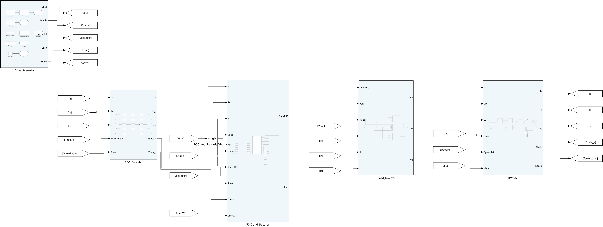
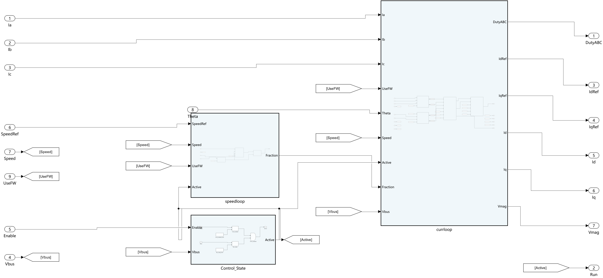

# 02 · IPMSM 弱磁扩速：可读移植版

**为什么母线电压没变，电机却能转得更快？**

转速升高时，反电动势也会升高，逆变器能够提供的电压逐渐吃紧。这个工程通过调整 d/q 轴电流分配，在电压和电流约束内比较常规 MTPA 与弱磁策略，观察速度、转矩和电流如何变化。

**[下载完整工程 ZIP](https://github.com/YANG985-CMD/motor-control-simulink-examples/releases/download/morimoto-1990-v1.0.0/morimoto1990-ipmsm-field-weakening-readable-v1.0.0.zip)** · [发布页面](https://github.com/YANG985-CMD/motor-control-simulink-examples/releases/tag/morimoto-1990-v1.0.0) · [文件与 SHA-256 清单](package-manifest.json)

## 论文依据

S. Morimoto; Y. Takeda; T. Hirasa; K. Taniguchi, **1990**.

*Expansion of Operating Limits for Permanent Magnet Motor by Current Vector Control Considering Inverter Capacity*.

IEEE Transactions on Industry Applications, 26(5), 866–871. [DOI: 10.1109/28.60058](https://doi.org/10.1109/28.60058)

学习重点是论文中“考虑逆变器容量，通过电流矢量控制扩展运行范围”的思路：把电流限制与随转速变化的电压限制放在同一张 d/q 图上，理解可运行区域如何变化。本工程将这一思路实现为可展开的离散控制模型；下表数字来自本工程仿真，论文参数包络另见 `paper_envelope.csv`。

## 打开后能看到什么



| 文件或目录 | 用途 |
|---|---|
| `IPMSM_FW_Drive.slx` | 工况、同步采样、控制器、PWM/逆变器、电机与机械负载组成的整机试验台 |
| `IPMSM_FW_Controller.slx` | 独立离散 FOC 控制器，包含速度环、电流分配、d/q PI、解耦前馈和 SVPWM |
| `morimoto_params.sldd` | 集中管理电机参数、控制增益与查表数据 |
| `open_readable.m` / `run_readable.m` | 打开模型 / 执行两种策略的仿真与代码生成 |
| `init_morimoto.m` / `rebuild_parameters.m` | 参数定义 / 更新查表、参数文件和数据字典 |
| `results` | 完整原始结果、可绘图 CSV、C 回放输入/输出与验证记录 |
| `generated_c` | 已生成的控制器 C/H 源文件 |
| `board_adapter_example.c/.h` | 采样输入、控制调用、PWM 计数换算的板级接口示例 |
| `model_images` / `建模规则.md` | 分层模型大图 / 布局与模块移植规则 |

推荐阅读顺序：整机顶层 → `FOC_Model` → `currloop` → `idq_Controller`。关键算法展开为原生块；同类 d/q 支路保持一致的接口与布局。



## 运行环境

| 任务 | 依赖 |
|---|---|
| 打开模型、运行仿真 | 已验证 MATLAB R2024b + Simulink |
| 重新生成 ERT C | Simulink Coder + Embedded Coder |
| 编译并回放已有 C | Python + NumPy + GCC；已验证 MinGW GCC 13.1.0 |

## 运行方法

压缩包保留指定目录的原始内容，入口脚本默认将缓存写入 `E:/simulink/_codex_tmp`。**有 E 盘的 Windows 环境**先创建该目录，然后在 MATLAB 中切换到解压后的工程目录：

```matlab
if ~isfolder('E:/simulink/_codex_tmp')
    mkdir('E:/simulink/_codex_tmp');
end
open_readable
run_readable([], false)  % 运行常规 MTPA 与弱磁两种策略
```

准备好代码生成产品后，执行：

```matlab
run_readable            % 仿真并生成 ERT C
```

**使用其他盘符或系统**时，先切换到解压目录，显式传入自己的缓存目录执行仿真：

```matlab
runtimeRoot = tempname(tempdir);
run_readable(runtimeRoot, false);
```

需要直接浏览模型时，可将 `open_readable.m` 中的 `tempname('E:/simulink/_codex_tmp')` 改为自己的缓存根目录。Python 回放脚本中的 `base` 也使用相同的 E 盘约定，并要求 `--runtime` 位于该目录之下；更换盘符时一并调整 `base`。编译器可通过 `--gcc` 指定：

```text
python verify_generated_c.py --gcc "D:/mingw64/bin/gcc.exe"
```

运行会更新解压工程的 `results`，如需保留发布时的数据，可先复制一份工程。

## 同一台电机的比较结果

母线电压 **86.60254 V**，目标转速 **4200 rpm**，电流矢量指令上限 **30 A**，d 轴电流下限 **-21.6 A**。控制周期 **100 μs**，开关仿真步长 **2.5 μs**。末段平均值统计窗口为 **1.55–1.65 s**。

| 指标 | 常规 MTPA | 弱磁策略 |
|---|---:|---:|
| 末段平均转速 / rpm | 2274.96 | 4199.96 |
| 末段平均 d 轴电流 / A | -0.931 | -12.422 |
| 末段平均 q 轴电流 / A | 4.805 | 3.388 |
| 采样控制输出的最大电压矢量幅值 / V | 49 | 49 |

在相同母线条件下，弱磁策略改变电流分配，使电机达到当前工况的目标转速。完整指标见 [metrics.json](metrics.json)，原始时间序列保存在压缩包的 `results/*_raw.mat`。

## 验证记录与控制器移植

| 检查 | 已有结果 |
|---|---|
| 布局重构前后的底层输入连接 | 452 个保持一致 |
| 两组完整仿真时间序列 | 重构前后逐点一致 |
| 独立控制器代码生成 | 仅复制控制器模型与数据字典即可生成 ERT C |
| 生成 C 的主机编译与回放 | 两种策略分别回放 16,501 个控制周期 |
| 回放最大占空比绝对误差 | 2.3841858e-07 |
| 回放最大电压幅值绝对误差 | 1.9073486e-05 V |
| 板级适配示例 | 已编译 |
| 硬件执行 | 待开展 |

详见 [acceptance.json](acceptance.json) 与 [code_replay_checks.json](code_replay_checks.json)。这些记录来自打包工程中已有的验证；发布时再次核对了文件清单与压缩包内容。

迁移时将 `IPMSM_FW_Controller.slx` 与 `morimoto_params.sldd` 一起复制。初始化调用 `IPMSM_FW_Controller_initialize()`，随后每 100 μs 更新同步采样输入并调用 `IPMSM_FW_Controller_step()`。接口单位、相序与 PWM 适配说明见压缩包内的 `README.md`。

## 下载校验

- 文件数：**51**。
- 压缩包大小：**80,122,285 字节**。
- SHA-256：`410a6659f6f79bc98e71dd205a2388b348d5a8ec5d280276feae71ca999f6dc0`。

`package-manifest.json` 同时列出包内每个文件的 SHA-256，可核对下载和解压是否完整。
