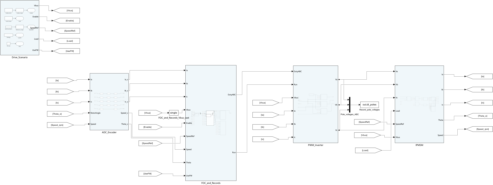
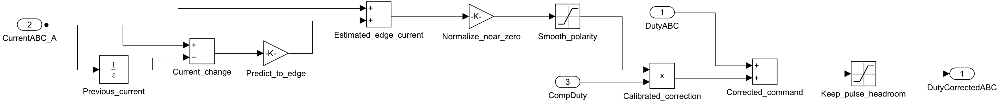

# 03 · 逆变器死区补偿与 PMSM 电流过零

**[下载完整工程 ZIP](https://github.com/YANG985-CMD/motor-control-simulink-examples/releases/download/choi-sul-1996-v1.0.0/choi-sul-1996-pmsm-dead-time-compensation-v1.0.0.zip)** · [发布页面](https://github.com/YANG985-CMD/motor-control-simulink-examples/releases/tag/choi-sul-1996-v1.0.0) · [SHA-256 与文件清单](package-manifest.json)

这份工程沿用第 02 期的离散 FOC 和 IPMSM，在同一个 10 kHz 开关逆变器上切换死区补偿。300 rpm、0.7 N·m、86.6 V 母线与 3 μs 的桥臂死区在两组中一致。

## 模型预览





## 运行

用 MATLAB R2024b 和 Simulink 打开解压后的工程目录。在 MATLAB 命令行执行：

```matlab
open_system('PMSM_DeadTime_Drive')
metrics = run_deadtime;
```

建议先看顶层的采样、FOC、逆变器和电机，再进 `FOC_and_Records` 打开 `PWM_DT_Comp`。打开模型后直接按 Run 使用默认的关闭补偿设置。`run_deadtime` 会完成标定和两组对照，并重新写入 `results`。可以给 `run_deadtime` 传入自选缓存目录，例如 `run_deadtime('D:/work/deadtime-run')`。如果此前打开过同名的第 02 期 FOC 模型，请关闭它后再打开本工程。

| 文件 | 用途 |
|---|---|
| `PMSM_DeadTime_Drive.slx` | ADC、编码器、FOC、开关级桥臂、IPMSM 和机械负载 |
| `PWM_DT_Comp.slx` | 可单独生成 C 的占空比补偿器 |
| `IPMSM_FW_Controller.slx` | 与第 02 期共用的原生块 FOC。本期将弱磁选项固定关闭 |
| `morimoto_params.sldd` | 电机、采样、控制及补偿参数 |
| `results` | 逐 PWM 周期数据、1 μs 开关片段、标定点、频谱和 C 回放数据 |
| `model_images` | 整机、补偿块、三相桥及单相桥臂的真实导出图 |

## 论文与教学实现

Jong Woo Choi、Seung Ki Sul，1996。*Inverter Output Voltage Synthesis Using Novel Dead Time Compensation*. IEEE Transactions on Power Electronics 11(2), 221–227。 [IEEE DOI](https://doi.org/10.1109/63.486169) · [作者机构记录及摘要](https://research.knu.ac.kr/en/publications/inverter-output-voltage-synthesis-using-novel-dead-time-compensat-2/)

作者机构摘要说明，论文以 SVPWM 修正逆变器输出电压，可由控制器在初始化自动完成，无需额外硬件。亚微秒级补偿能力来自原文摘要所述的实验。现有资料核对到该摘要，以下标定、边沿预测和波形属于本期针对 PMSM 的教学实现。

1. 在无补偿的一次仿真中，使用 0.34–0.49 s 作为标定段。由 d/q 电流及机械转速，按离散 PMSM 方程反算每个快步的相电压，然后按 100 μs 的 PWM 周期取平均。真实桥臂电压只用于独立交叉核对反算结果。
2. 筛出三个相电流极性都较稳定的周期。先去掉三相共模，然后将「输出减指令」的相电压误差对电流极性做最小二乘拟合，得到 2.310 V 的等效误差幅值。换算后对应 2.668 μs 或 2.668% 占空比。这个系数包含开关时序、采样与有限仿真步长共同作用后的平均效果。
3. 每周期对三个相电流用前后采样差做短步外推。预测值超过 ±0.23 A 时按极性加减上述占空比，区间内用线性过渡。控制输出限在 0.03–0.97。PWM 逆变器保持原来的 3 μs 死区。
4. 用与标定分离的 0.55–0.88 s 段评价。电压误差为去共模后的三个相电压周期均值相对 FOC 指令的综合 RMS。电流先按每个 PWM 周期平均，再对完整电周期做电角度等间隔重采样。过零偏差以各自基波在 ±0.35 A 范围内的 RMS 计算，THD 使用 2–25 次谐波。

## 该工况结果

| 指标 | 关闭补偿 | 打开补偿 |
|---|---:|---:|
| 相电压跟踪误差 RMS | 2.126 V | 0.716 V |
| A 相过零区域相对基波偏差 RMS | 0.192 A | 0.169 A |
| A 相 2–25 次 THD | 10.54% | 7.54% |
| A 相第 5 次谐波 / 基波 | 8.54% | 5.75% |
| A 相第 7 次谐波 / 基波 | 5.98% | 3.94% |

第 11、13 次谐波上升，频谱和过零放大图保留了这一工况的实际形状。原始数据、采样定义和精确值见 `results/metrics.json`、`phase_a_cycle.csv`、`harmonics.csv`。开关桥臂按电流极性选择续流电位。半导体寄生电容、导通压降和温度效应可作为后续扩展。

## C 代码与接板接口

`build_embedded` 需要 Simulink Coder 和 Embedded Coder。先关闭模型，运行该命令；它会分别在只包含控制模型和字典的独立目录中生成 C/H。已有生成代码保存在 `generated_c`。使用 Python 3 与 GCC 执行：

```text
python verify_c.py --gcc D:/mingw64/bin/gcc.exe
```

两个控制器的 C 均已用 GCC 编译。补偿器主机回放两组各 9,000 个周期，三个占空比输出与 Simulink 逐点相等。硬件验证状态为待开展。

| 补偿器端口 | 类型与含义 |
|---|---|
| `DutyABC[3]` | `single`，按 A-B-C 排列的归一化原占空比 |
| `CurrentABC_A[3]` | `single`，与 PWM 同步采样的三相电流，正方向为逆变器流向电机 |
| `CompDuty` | `single`，标定得到的归一化占空比增量，0 表示关闭修正 |
| `DutyCorrectedABC[3]` | `single`，修正后的归一化占空比 |

在同步采样中断里，先更新 FOC 再执行 `PWM_DT_Comp_step()`，每 100 μs 一次。上电后先调用 `PWM_DT_Comp_initialize()` 清除上一次电流状态。定时器在安全更新点同步写入三相比较值，互补驱动、硬件死区和关断联锁由实际板级代码配置。换板或改 PWM 频率后，应按新的电流采样相位与器件特性重新标定。


[精确仿真指标](metrics.json) · [过零曲线 CSV](phase_a_cycle.csv) · [谐波 CSV](harmonics.csv) · [C 回放报告](c_replay.json) · [验收记录](acceptance.json)
