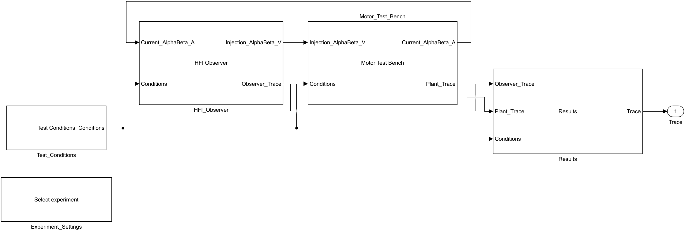

# 04 · 凸极 IPMSM 高频注入

七组工况包含静止注入、关闭注入、采样噪声、60 rpm、5000 rpm、高速关闭前馈和反向初始极性。选择相应名称后运行，观察真实角度、估计角度、电角速度和注入电流。

[下载直接运行包](https://github.com/YANG985-CMD/motor-control-simulink-examples/releases/download/open-and-run-v2.0.0/04-corley-lorenz-1998-high-frequency-injection-open-and-run.zip) · [查看运行验证](verification/open-and-run.json)

## 打开与运行

1. 下载并解压运行包，或者下载本仓库后进入本例的 `model` 文件夹。
2. 将 MATLAB 当前文件夹切换到该目录。
3. 打开 **CorleyLorenz1998_HFI.slx**，点击「运行」。Scope 显示结果曲线。

双击顶层的 **Experiment_Settings**，在 **Experiment** 下拉框选择工况，再点「运行」。默认选中 `low_speed`。

本例采用 **.slx + .sldd**。保留独立参数字典，便于查看电机与控制参数，以及复用离散控制器。

- [CorleyLorenz1998_HFI.sldd](model/CorleyLorenz1998_HFI.sldd)
- [CorleyLorenz1998_HFI.slx](model/CorleyLorenz1998_HFI.slx)

控制器、采样、逆变器和电机保留在主模型的分层子系统中，可以逐层双击查看原生模块。默认工况已经随模型保存。

## 运行验证

使用 MATLAB R2024b 和 Simulink，在干净会话中只复制上述模型文件，直接运行了 7 组工况。与原工程对应轨迹逐点核对，最大绝对差见 [open-and-run.json](verification/open-and-run.json)。图表读数来自本工程仿真。

## 论文依据

M. J. Corley; R. D. Lorenz (1998). *Rotor position and velocity estimation for a salient-pole permanent magnet synchronous machine at standstill and high speeds*.

[论文 DOI](https://doi.org/10.1109/28.703973)

## 配套记录

本目录保留已有的原始指标与验证记录。本次重新打包的运行验证单独记录在 `verification/open-and-run.json`，历史发布可从仓库 Releases 查看。

顶层按 Test_Conditions、HFI_Observer、Motor_Test_Bench、Results 四个区域组织。点开区域后可查看对应原生模块。

[观测器接口](images/open-and-run-HFI_Observer.png) · [电机台架](images/open-and-run-Motor_Test_Bench.png) · [结果显示与记录](images/open-and-run-Results.png)

Conditions 向量依次保存电角速度（rad/s）、前馈转矩（N·m）、注入电压（V）、d 轴前馈开关、α 轴噪声（A）和 β 轴噪声（A）。模型工作区的 RecordedSignalNames 记录 Trace 各列的名称。
