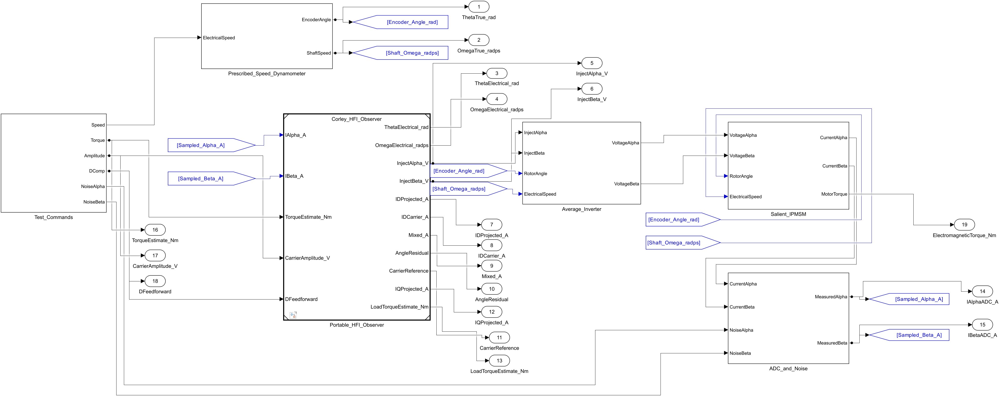
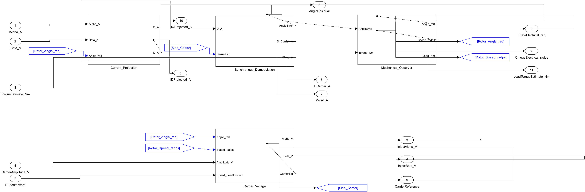

# Corley 与 Lorenz 1998 · 高频注入位置估计

在同一台 48 V 凸极 IPMSM 上，沿估计 q 轴注入 2 kHz 电压，从估计 d 轴电流解调位置残差。工程有 0 rpm 开关对照、噪声、60 rpm、5000 rpm、高速前馈开关对照和 180° 极性共七组工况。

[下载完整工程 ZIP](https://github.com/YANG985-CMD/motor-control-simulink-examples/releases/download/corley-lorenz-1998-v1.0.0/corley-lorenz-1998-ipmsm-hfi-v1.0.0.zip)，包含 Simulink 模型、数据字典、原始轨迹、生成的 ERT C 和两种回放验证入口。

## 真实模型图





[查看载波电压子系统](images/carrier_voltage.png) · [查看同步解调子系统](images/synchronous_demodulation.png)

## 运行

需要 MATLAB R2024b 和 Simulink。将当前文件夹切换到仿真工程根目录，执行：

```matlab
open_system('Corley_IPMSM_HFI_Bench')
run_corley_hfi
```

| 文件 | 用途 |
|---|---|
| Corley_IPMSM_HFI_Bench.slx | 工况、理想测速台、平均逆变器、IPMSM、ADC 噪声及真实值与估计值记录 |
| Corley_HFI_Observer.slx | 独立的离散观测器。包含估计坐标投影、带通和同步解调、机械观测器、载波生成 |
| corley_hfi_parameters.sldd | 固定采样周期、载波、模型与观测器参数 |
| results/corley_hfi_traces.mat | 七组原始轨迹和统计结果 |
| results/metrics.json | 角度、速度、锁定时间和注入电流 |
| model_images | 模型导图 |

仿真电机用两对极、0.24 Ω、Ld 0.45 mH、Lq 0.80 mH 和 0.013 Wb。采样与模型积分周期 25 μs，额定注入幅值 4 V。真实转速由理想测速台给定，真实角度用于生成台架基波反电动势抵消项和做误差对照。可移植观测器的输入只有采样电流、转矩估计、注入幅值和前馈开关。高速工况的转矩前馈从台架给定加速度和惯量换算。

所有工况使用同一台电机模型。逆变器采用带直流母线限幅的平均电压模型，电机使用原生块计算的 dq 电压方程和电磁转矩。独立轴线估计没有引入饱和极性判别，180° 工况同时报告轴线误差与完整电角度误差。

## 仿真结果

| 工况 | 电角度 RMS | 备注 |
|---|---:|---|
| 0 rpm，开启注入 | <0.001° | 40 kHz 采样，2 kHz 载波 |
| 0 rpm，关闭注入 | 35.00° | 保持起始误差 |
| 0 rpm，采样有噪声 | 1.84° | α、β 轴各加 0.06 A RMS 白噪声 |
| 60 rpm | 0.02° | d 轴速度前馈开启 |
| 5000 rpm，前馈开启 | 1.46° | d 轴速度补偿有效 |
| 5000 rpm，前馈关闭 | 2.71° | 相同电机与转速轨迹 |
| 起始相差 180° | 180.00° | 轴线重合，磁极朝向相反 |

统计窗口为 0.95–1.10 s。静止开启注入约 22.0 ms 后首次连续 30 ms 位于 ±2° 内。锁定后，q 轴载波电流约 0.28 A RMS。

## 生成 C

关闭仿真模型后执行 `build_embedded`，需要 Simulink Coder 和 Embedded Coder。脚本仅复制观测器与数据字典到独立目录生成 ERT C。主机验证使用记录的 ADC 输入，核对每组前 40 ms 的启动短窗和重复初始化。需要 Python 3、NumPy、SciPy 和 GCC。

```text
python verify_c.py --gcc gcc
```

控制边界每 25 μs 调用一次。依次写入 α/β 电流（A）、估计电磁转矩（N·m）、注入电压峰值（V）和 d 轴速度前馈（0 或 1），再读取电角度（rad）、电角速度（rad/s）和 α/β 注入电压（V）。固件侧负责同步 ADC 触发、逆变器电压合成、有效区判定和磁极初始极性识别。启动短窗的编译回放共 11,207 点。结果见 `results/host_replay.json`。

## 闭环软件在环

运行 `verify_corley_sil` 可让同一 Simulink 台架的 Model 块执行编译后的顶层 ERT C。七组全程共 308,007 点，角度最大差小于 0.001°，机械转速最大差小于 0.03 rpm。测试报告在 `results/sil_replay.json`。载波方向随估计角度变化，软件在环保留了采样、电机与注入指令的闭环关系。

## 论文与方程

- Matthew J. Corley and Robert D. Lorenz (1998), *Rotor Position and Velocity Estimation for a Salient-Pole Permanent Magnet Synchronous Machine at Standstill and High Speeds*, *IEEE Transactions on Industry Applications*, 34(4), 784–789. [原始出版记录](https://doi.org/10.1109/28.703973)
- 作者在 1996 年 IAS 会议发表的前身原稿。式 (3) 为 q 轴注入磁链，式 (10) 为 d 轴载波电流，式 (15) 给出 q 轴余弦注入和 d 轴速度电压前馈。图 2 为解调和机械观测器，图 3 为整机结构。[作者会议原稿](https://transistor-man.com/files/3phase_drive_mk2/research/1.pdf)

令 φ 为载波相位，δ 为真实电角度减估计电角度。沿估计 q 轴的磁链取 Λ sinφ。其电压主分量为 Vc cosφ，旋转补偿为 d 轴上的 −Vc (ω̂/ωc) sinφ。忽略高频电阻压降时，估计 d 轴载波电流为 Λ (1/Ld − 1/Lq) sin(2δ) sinφ / 2。乘同频参考再低通后，残差的符号给出局部修正方向。工程使用数字带通和低通、离散机械观测器及独立电机参数，以同一推导验证现象。

期刊的实验数据和这里的仿真数据分别标注。原论文使用 10 kHz 逆变器开关频率、2 kHz 载波，展示了 4.6 r/min 与 5000 r/min 的实测跟踪。

## 验证记录

- [七组对照指标](verification/metrics.json)
- [相同启动采样的 C 回放](verification/host_replay.json) · [闭环软件在环](verification/sil_replay.json)
- [布局检查](verification/layout_audit.json) · [文件校验值](package-manifest.json)
