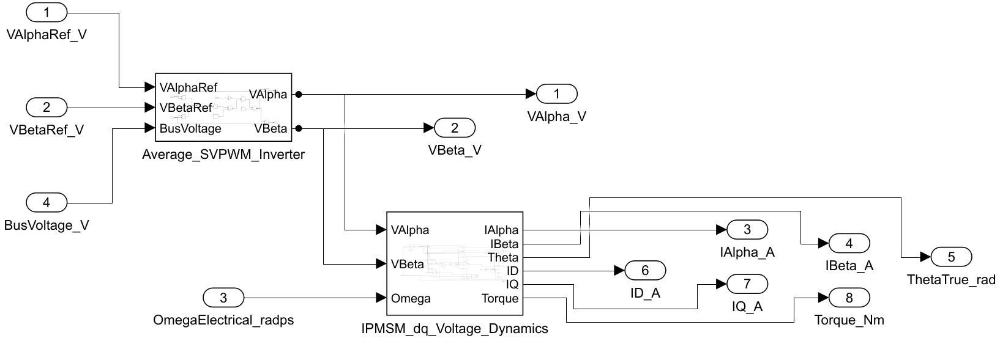
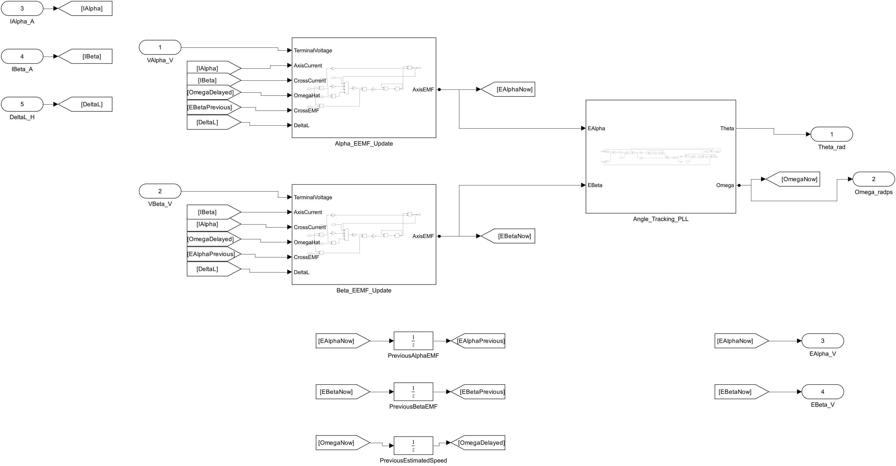

# 内嵌式电机的转子角度，为什么更难估？

Zhiqian Chen · M. Tomita · S. Doki · S. Okuma，2003，An Extended Electromotive Force Model for Sensorless Control of Interior Permanent-Magnet Synchronous Motors。 [IEEE 出版记录](https://doi.org/10.1109/TIE.2003.809391)

对照从同一台 IPMSM 测试台记录 αβ 电压、电流，使用相同的 50 μs 周期、观测器增益和初始条件。对照组的电感差输入为零，扩展模型组的输入为 Lq − Ld = 1.5 mH。电角速度由测功台固定在 320 rad/s，q 轴电流从约 2 A 升至 12 A。台架采用平均 SVPWM 逆变器、标称电机参数与同步采样。比较对象是角度估计，编码器角度只用于工况和评估。论文的扩展反电动势重排用于本模型，观测器采用本工程的离散增益与角度跟踪环。

稳态电角度 RMS（0.37–0.50 s）由 21.77° 降至 0.033°。过渡 RMS（0.20–0.28 s）由 20.43° 降至 0.027°。

板级接入时，每 50 μs 同步输入电机端 αβ 电压、电流，电压单位 V，电流单位 A，电感差单位 H。输出角度为电角 rad，速度为电角 rad/s。电压可由实测母线和实际开关状态重构，采样时刻由板级定时器协调。


[下载完整工程 ZIP](https://github.com/YANG985-CMD/motor-control-simulink-examples/releases/download/chen-2003-v1.0.0/chen-2003-ipmsm-extended-emf-v1.0.0.zip)

## 真实模型图





[查看关键算法子系统](images/detail.png) · [查看另一处关键结构](images/second.png)

## 运行

用 MATLAB R2024b 和 Simulink 打开工程。在 MATLAB 中把当前文件夹切到解压后的工程根目录，然后运行。

```matlab
run_comparisons
```

台架位于 sim/Chen_IPMSM_Dyno_Bench，控制核心位于 sim/Chen_EEMF_Observer。每个模型的参数字典与模型放在同一目录。结果写入工程根目录。运行缓存默认放在系统临时目录，也可以把指定的可写目录作为 run_comparisons 的参数。

## 生成 C 与主机回放

使用 Simulink Coder 和 Embedded Coder，运行 generate_portable，从独立控制核心和参数字典生成 ERT C。工程同时附上已生成的 C 文件。使用 Python、NumPy、SciPy 和 GCC，回放两组相同输入。

```text
python verify_c.py Chen_EEMF_Observer --directory . --runtime ./replay_tmp
```

同一台 IPMSM 的两组角度估计，共 20,802 点 C 回放。 comparison.mat 保存原始采样，metrics.json 记录指标与统计区间，video.json 保存视频绘图数据。host_replay.json 记录逐样本误差，layout_trace_parity.json 记录整理布局前后的数据一致性。

## 验证记录

- [对照指标](verification/metrics.json)
- [同采样 C 回放](verification/host_replay.json) · [布局整理前后的一致性](verification/layout_trace_parity.json)
- [下载包和文件校验值](package-manifest.json)
