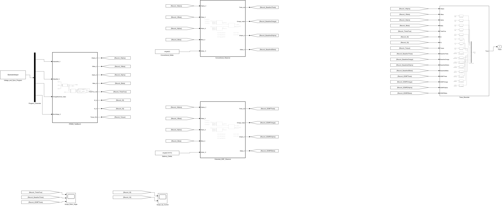

# 05 · IPMSM 扩展反电动势

同一台凸极 IPMSM 的电压、电流同时送入传统反电动势观测器和扩展反电动势观测器。默认在 0.20 秒改变 q 轴电流，观察两路位置估计。两个观测器和真实电机均可展开。

[下载直接运行包](https://github.com/YANG985-CMD/motor-control-simulink-examples/releases/download/open-and-run-v2.0.0/05-chen-2003-extended-emf-open-and-run.zip) · [查看运行验证](verification/open-and-run.json)

## 打开与运行

1. 下载并解压运行包，或者下载本仓库后进入本例的 `model` 文件夹。
2. 将 MATLAB 当前文件夹切换到该目录。
3. 打开 **Chen2003_ExtendedEMF.slx**，点击「运行」。Scope 显示结果曲线。

本例采用 **.slx**。参数和测试数据保存在模型内，适合直接打开学习。

- [Chen2003_ExtendedEMF.slx](model/Chen2003_ExtendedEMF.slx)

控制器、采样、逆变器和电机保留在主模型的分层子系统中，可以逐层双击查看原生模块。默认工况已经随模型保存。

## 运行验证

使用 MATLAB R2024b 和 Simulink，在干净会话中只复制上述模型文件，直接运行了 1 组工况。与原工程对应轨迹逐点核对，最大绝对差见 [open-and-run.json](verification/open-and-run.json)。图表读数来自本工程仿真。

## 论文依据

Zhiqian Chen; M. Tomita; S. Doki; S. Okuma (2003). *An extended electromotive force model for sensorless control of interior permanent-magnet synchronous motors*.

[论文 DOI](https://doi.org/10.1109/TIE.2003.809391)

## 配套记录

本目录保留已有的原始指标与验证记录。本次重新打包的运行验证单独记录在 `verification/open-and-run.json`，历史发布可从仓库 Releases 查看。
