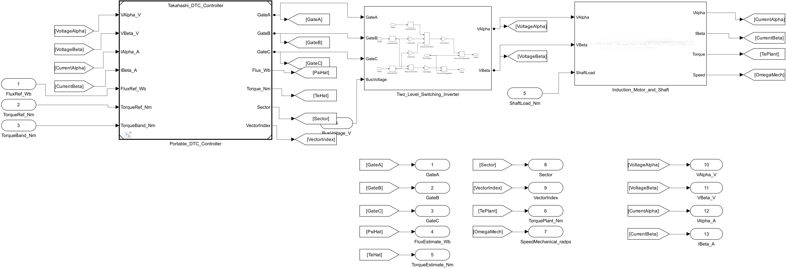
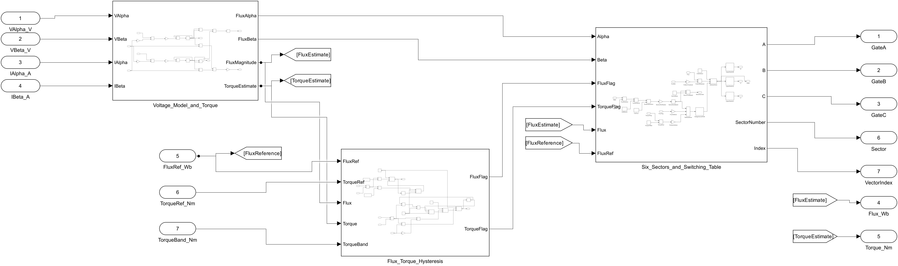

# 能不能直接管住电机转矩？

Isao Takahashi · Toshihiko Noguchi，1986，A New Quick-Response and High-Efficiency Control Strategy of an Induction Motor。 [IEEE 出版记录](https://doi.org/10.1109/TIA.1986.4504799)

同一异步电机、100 V 直流母线、相同负载与 25 μs 控制节拍。比较 0.40 N·m 与 0.15 N·m 两种转矩滞环带宽。按磁链和转矩误差查六扇区开关表，转矩比较器在回到目标附近时切入零矢量。台架增加预励磁和一拍开关施加延迟，异步电机和逆变器采用独立模块。

3 → 7 N·m 阶跃达到 90% 的时间分别为 0.95 与 0.80 ms。稳态峰峰值分别为 0.692 与 0.576 N·m。0.49–0.57 s 内每相平均每秒切换 3067 与 6858 次，按边沿计数。

板级接入时，每 25 μs 输入同步 αβ 端电压与电流、磁链命令、转矩命令和滞环带宽。三路上管输出为 0 或 1，板级驱动层负责互补、死区、过流关断和失能。


[下载完整工程 ZIP](https://github.com/YANG985-CMD/motor-control-simulink-examples/releases/download/takahashi-noguchi-1986-v1.0.0/takahashi-noguchi-1986-induction-motor-dtc-v1.0.0.zip)

## 真实模型图





[查看关键算法子系统](images/detail.png) · [查看另一处关键结构](images/second.png)

## 运行

用 MATLAB R2024b 和 Simulink 打开工程。在 MATLAB 中把当前文件夹切到解压后的工程根目录，然后运行。

```matlab
run_comparisons
```

台架位于 sim/Takahashi_Induction_DTC_Bench，控制核心位于 sim/Takahashi_DTC_Controller。每个模型的参数字典与模型放在同一目录。结果写入工程根目录。运行缓存默认放在系统临时目录，也可以把指定的可写目录作为 run_comparisons 的参数。

## 生成 C 与主机回放

使用 Simulink Coder 和 Embedded Coder，运行 generate_portable，从独立控制核心和参数字典生成 ERT C。工程同时附上已生成的 C 文件。使用 Python、NumPy、SciPy 和 GCC，回放两组相同输入。

```text
python verify_c.py Takahashi_DTC_Controller --directory . --runtime ./replay_tmp
```

同一台异步电机的两组滞环带宽试验，共 49,602 点 C 回放。 comparison.mat 保存原始采样，metrics.json 记录指标与统计区间，video.json 保存视频绘图数据。host_replay.json 记录逐样本误差，layout_trace_parity.json 记录整理布局前后的数据一致性。

## 验证记录

- [对照指标](verification/metrics.json)
- [同采样 C 回放](verification/host_replay.json) · [布局整理前后的一致性](verification/layout_trace_parity.json)
- [下载包和文件校验值](package-manifest.json)
