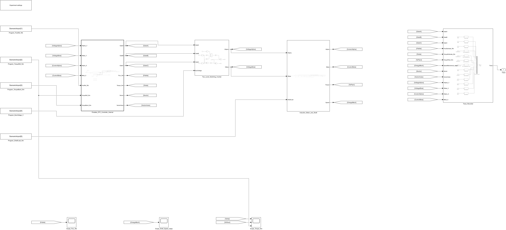

# 06 · 异步电机直接转矩控制

Wide_band_0p40Nm 和 Narrow_band_0p15Nm 两组工况使用同一台异步电机。转矩指令从 3 N·m 提到 7 N·m，比较磁链、转矩响应和开关行为。

[下载直接运行包](https://github.com/YANG985-CMD/motor-control-simulink-examples/releases/download/open-and-run-v2.0.0/06-takahashi-noguchi-1986-direct-torque-control-open-and-run.zip) · [查看运行验证](verification/open-and-run.json)

## 打开与运行

1. 下载并解压运行包，或者下载本仓库后进入本例的 `model` 文件夹。
2. 将 MATLAB 当前文件夹切换到该目录。
3. 打开 **Takahashi1986_DTC.slx**，点击「运行」。Scope 显示结果曲线。

双击顶层的 **Experiment_Settings**，在 **Experiment** 下拉框选择工况，再点「运行」。默认选中 `Narrow_band_0p15Nm`。

本例采用 **.slx + .sldd**。保留独立参数字典，便于查看电机与控制参数，以及复用离散控制器。

- [Takahashi1986_DTC.sldd](model/Takahashi1986_DTC.sldd)
- [Takahashi1986_DTC.slx](model/Takahashi1986_DTC.slx)

控制器、采样、逆变器和电机保留在主模型的分层子系统中，可以逐层双击查看原生模块。默认工况已经随模型保存。

## 运行验证

使用 MATLAB R2024b 和 Simulink，在干净会话中只复制上述模型文件，直接运行了 2 组工况。与原工程对应轨迹逐点核对，最大绝对差见 [open-and-run.json](verification/open-and-run.json)。图表读数来自本工程仿真。

## 论文依据

Isao Takahashi; Toshihiko Noguchi (1986). *A New Quick-Response and High-Efficiency Control Strategy of an Induction Motor*.

[论文 DOI](https://doi.org/10.1109/TIA.1986.4504799)

## 配套记录

本目录保留已有的原始指标与验证记录。本次重新打包的运行验证单独记录在 `verification/open-and-run.json`，历史发布可从仓库 Releases 查看。
