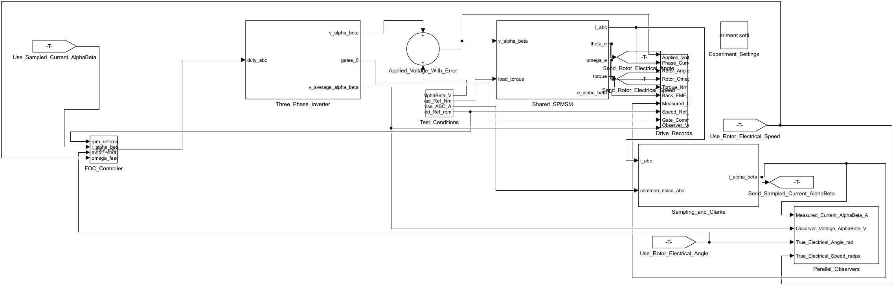

# 专题 · SMO 与 Luenberger 观测器对比

同一台 PMSM 的同一份采样信号送入两路观测器。十二组工况覆盖标称、噪声、参数失配、低速、零速、两种 CCF 设置、开关逆变器、电压偏差、电流脉冲、热电阻和重负载。

[下载直接运行包](https://github.com/YANG985-CMD/motor-control-simulink-examples/releases/download/open-and-run-v2.0.0/smo-luenberger-pmsm-observers-open-and-run.zip) · [查看运行验证](verification/open-and-run.json)

## 打开与运行

1. 下载并解压运行包，或者下载本仓库后进入本例的 `model` 文件夹。
2. 将 MATLAB 当前文件夹切换到该目录。
3. 打开 **PMSM_SMO_Luenberger.slx**，点击「运行」。Scope 显示结果曲线。

双击顶层的 **Experiment_Settings**，在 **Experiment** 下拉框选择工况，再点「运行」。默认选中 `nominal`。

本例采用 **.slx**。参数和测试数据保存在模型内，适合直接打开学习。

- [PMSM_SMO_Luenberger.slx](model/PMSM_SMO_Luenberger.slx)

控制器、采样、逆变器和电机保留在主模型的分层子系统中，可以逐层双击查看原生模块。默认工况已经随模型保存。

## 运行验证

使用 MATLAB R2024b、Simulink、Stateflow，在干净会话中只复制上述模型文件，直接运行了 12 组工况。与原工程对应轨迹逐点核对，最大绝对差见 [open-and-run.json](verification/open-and-run.json)。图表读数来自本工程仿真。

## 论文依据

Rongfu Luo; Zenghui Wang; Yanxia Sun (2022). *Optimized Luenberger Observer-Based PMSM Sensorless Control by PSO*.

Wu Jingbo; Xie Chengwei; Guo Zhijun; Wang Yongwei (2023). *An optimized sliding-mode observer control algorithm for vehicle sensor-less PMSM*.

[论文 DOI](https://doi.org/10.1155/2022/3328719)

[SMO 论文 DOI](https://doi.org/10.1049/tje2.12253)

## 配套记录

本目录保留已有的原始指标与验证记录。本次重新打包的运行验证单独记录在 `verification/open-and-run.json`，历史发布可从仓库 Releases 查看。
