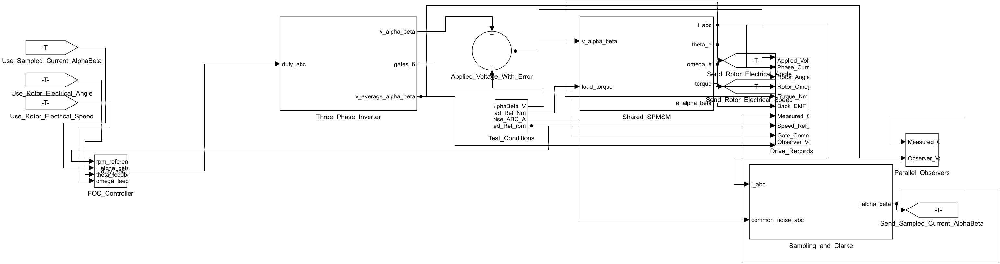
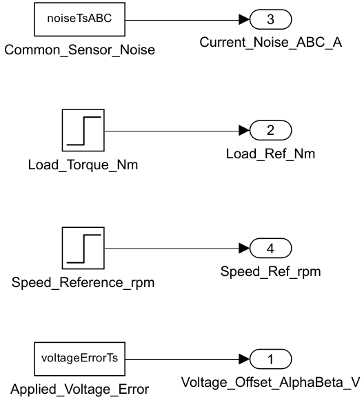
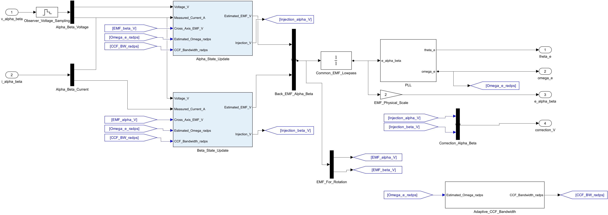

# PMSM 无位置传感器观测器对比

同一台 48 V 表贴式永磁同步电机，对照 Luenberger 观测器与边界层滑模观测器（SMO）。并行试验让两路观测器接收同一份电压和电流，闭环启动试验由各自的估计角度接管电机。

- [下载模型 ZIP](https://github.com/YANG985-CMD/motor-control-simulink-examples/releases/download/smo-luenberger-v1.0.0/pmsm-smo-luenberger-readable-models-v1.0.0.zip)，包含四个模型、两份参数字典、C 源码、闭环启动数据和回放脚本。
- [下载 12 组原始轨迹 MAT](https://github.com/YANG985-CMD/motor-control-simulink-examples/releases/download/smo-luenberger-v1.0.0/observer-comparison-original-traces.mat)，放入解压后的数据目录，可导出完整曲线。

## 模型导图







[查看 SMO 单轴内部计算](images/smo_alpha_update.png) · [查看闭环启动台架](images/startup.png)

## 打开与运行

本工程使用 MATLAB R2024b、Simulink 与 Stateflow。将 MATLAB 当前文件夹切换到解压目录，在命令行运行：

```matlab
addpath(fullfile(pwd,'comparison'),fullfile(pwd,'embedded'))
open_system('PMSM_Observer_Audit')
run_literature_validation
open_system('PMSM_Startup_Validation')
run_startup_validation
```

首次浏览时，先看整机模型，再进入 `Parallel_Observers`，对照两路共用的电压和电流。点开任一路可依次查看 `Alpha_State_Update`、`Beta_State_Update` 和 PLL。两轴以相同顺序接入电压、电流、交叉轴反电动势和估计电角速度，SMO 的最后一路是 `Adaptive_CCF_Bandwidth` 提供的带宽。双轴子系统使用原生 Simulink 块。

| 路径 | 用途 |
|---|---|
| `comparison/PMSM_Observer_Audit.slx` | 共同的 FOC、逆变器、电机、采样和两路观测器。覆盖 12 个工况，包含一组开关逆变器工况 |
| `embedded/PMSM_Startup_Validation.slx` | 平均电压试验台。通过 `ObserverMode` 分别执行启动、角度过渡和闭环接管 |
| `embedded/ObserverPair_Embedded.slx` | 可独立生成 C 的单精度双观测器 |
| `embedded/PMSM_EmbeddedFOC.slx` | 电流环、速度环、启动逻辑和调制，引用同目录双观测器 |
| `embedded/*.sldd` | 两个控制模型各自的参数字典 |
| `comparison/selected_parameters.mat` | 并行对比的冻结参数。两个 PSO 入口和训练历史可供复核 |
| `data/` | 原始并行对比轨迹单独下载。闭环和回放数据随工程 ZIP 提供 |
| `model_images/` | 实际模型导图，可放大读信号名 |

两个仿真入口可接收自选缓存目录。并行仿真默认输出到 `comparison/literature_results.mat`。闭环启动输出到 `embedded/results`。如果已打开旧工程的同名模型或数据字典，先关闭它们再打开本工程。

把下载的 `observer-comparison-original-traces.mat` 放入 `data`，即可用 Python 3、NumPy 和 SciPy 导出全部 CSV。也可以给脚本传入新生成的 MAT。[下载 12 组原始轨迹](https://github.com/YANG985-CMD/motor-control-simulink-examples/releases/download/smo-luenberger-v1.0.0/observer-comparison-original-traces.mat)

```text
python comparison/export_comparison.py
python comparison/export_comparison.py --data comparison/literature_results.mat
```

## 两套试验的含义

| 项目 | 并行观察 | 独立闭环启动 |
|---|---|---|
| 观测周期 | 50 μs | 100 μs |
| 电机 | 同一台 48 V SPMSM | 同一组电机参数 |
| 估计角度的用途 | 比较两路估计，电机控制使用共同的真实角度 | 状态 4 进行角度过渡，状态 5 由选定观测器接管 |
| 主要结果 | 角度和速度误差、各工况原始轨迹 | 启动状态、真实和估计速度、PWM 计数、电角度 |

并行组中 Luenberger 使用电流残差修正、160 Hz 反电动势低通及离散相位补偿。SMO 使用连续边界层、频率自适应复系数滤波和反电动势反馈。两路使用各自的 PLL 设置，速度诊断共用 40 Hz 输出低通。参数通过同预算的两阶段 PSO 冻结，验证条件与训练分开。

| 工况与指标 | Luenberger | SMO |
|---|---:|---:|
| 正常升速的电角度峰值误差 | 10.54° | 5.55° |
| 50 rpm 稳态电角度 RMS | 0.332° | 0.181° |
| 电流噪声工况的电角度 RMS | 0.085° | 0.099° |
| 指令电压偏差工况的电角度 RMS | 2.863° | 3.719° |

数据依工况给出。稳态窗口为 1.95–2.35 s，升速峰值窗口为 1.00–1.35 s，区间均按严格不等式选样。角度是电角度，RMS 包含均值偏差。

## 生成 C 和接口约定

关闭闭环试验台与两个控制模型后，执行 `build_embedded`。生成 ERT C 需要 Simulink Coder 与 Embedded Coder。脚本先将独立观测器及其字典复制到新目录，再将 FOC、观测器及两份字典复制到另一个新目录。两次分别构建。`generated_c` 中保留原样 C/H。

| 观测器接口 | 单位、格式和顺序 |
|---|---|
| `u_alpha` / `u_beta` | 单精度标量，α、β 轴电压，V |
| `i_alpha` / `i_beta` | 单精度标量，α、β 轴电流，A |
| `Motor_Enable` | 布尔使能。沿用原运行和复位语义 |
| `Observer_Mode` | `uint8`。0 选 Luenberger，1 选 SMO |
| `theta_selected` / `theta_luen` / `theta_smo` | 电角度，rad。供控制选用的角度映射到 [0, 2π) |
| `rpm_selected` / `rpm_luen` / `rpm_smo` | 机械转速，rpm |
| `emf_luen` / `emf_smo` | 单精度 2 元向量 [α, β]，V |

FOC 电流环按 100 μs 执行，速度环为 1 ms。FOC 输入包含 A、B、C 三相电流、机械转速指令、运行使能、母线和观测器选项。`Tcmp1–3` 是原工程的 A、B、C 定时器比较值接口，周期计数为 8000。`board_adapter.c/.h` 提供板级数据约定、使能和故障锁存示例。真实板上的 ADC 标定、PWM 时序和硬件关断由对应板级实现负责。

```matlab
addpath(fullfile(pwd,'embedded','replay'))
run_replay_sim
```
```text
python embedded/verify_host_replay.py --gcc gcc
```

12 组并行试验、2 组闭环启动和观测器回放都与重整前逐点一致。记录见 `comparison/parity.json` 和 `embedded/parity.json`。独立 ERT 构建见 `embedded/isolated_build.json`。主机编译、保护逻辑和 24,001 点 C 回放见 `embedded/host_replay_report.json`。当前验证范围为仿真、代码生成和主机回放。

## 论文出处

- Rongfu Luo, Zenghui Wang, Yanxia Sun (2022), *Optimized Luenberger Observer-Based PMSM Sensorless Control by PSO*. [论文 DOI](https://doi.org/10.1155/2022/3328719)
- Wu Jingbo, Xie Chengwei, Guo Zhijun, Wang Yongwei (2023), *An optimized sliding-mode observer control algorithm for vehicle sensor-less PMSM*. [论文 DOI](https://doi.org/10.1049/tje2.12253)

工程沿用论文的结构思路，在本项目电机上建立和整定。表中读数来自本工程的仿真。

## 验证记录

- [12 组对照逐点一致](verification/comparison_parity.json) · [闭环启动与回放逐点一致](verification/embedded_parity.json)
- [独立生成 ERT C](verification/isolated_build.json) · [GCC 编译与主机回放](verification/host_replay_report.json)
- [对照工况指标](verification/comparison_metrics.json) · [启动指标](verification/startup_metrics.json)
- [逐层布局检查](verification/layout_audit.json) · [下载文件校验值](package-manifest.json)
